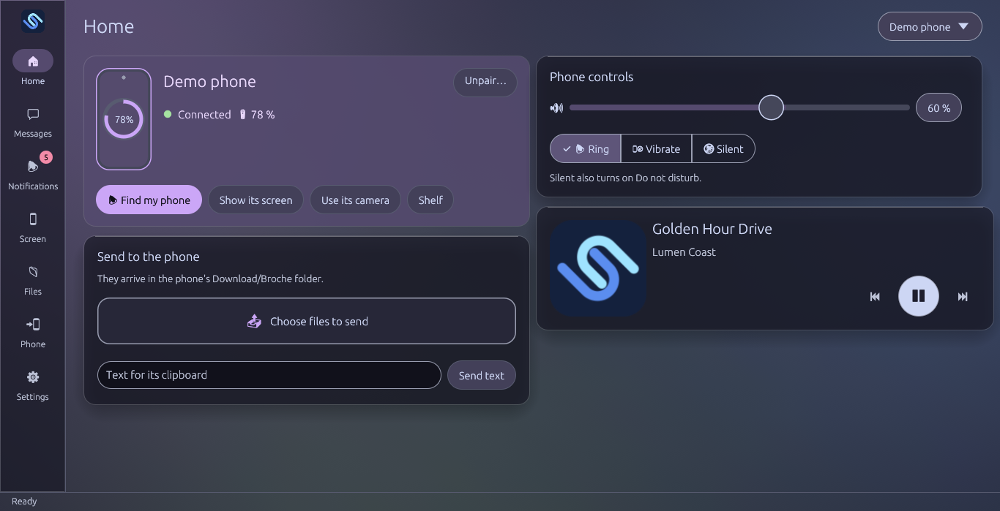
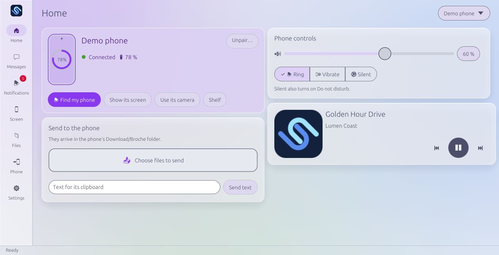
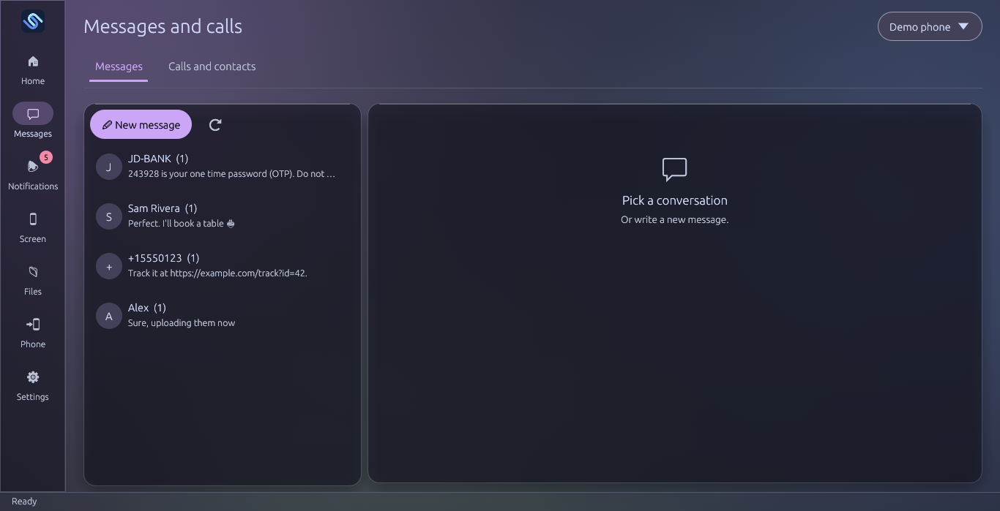
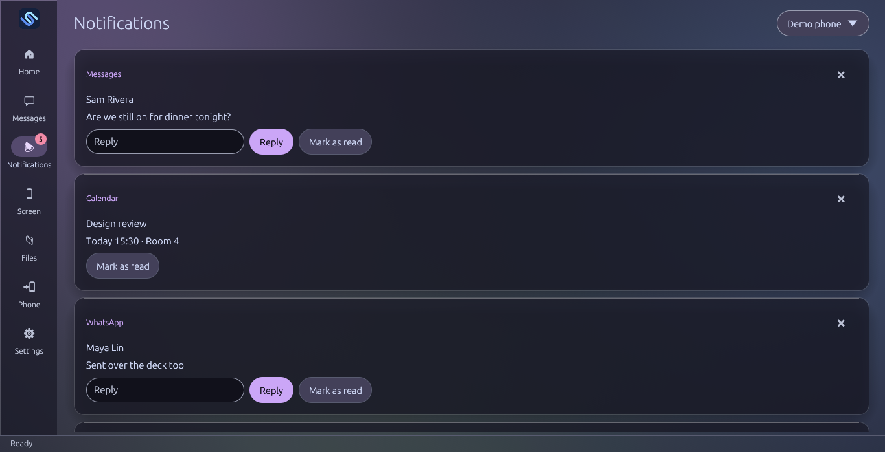
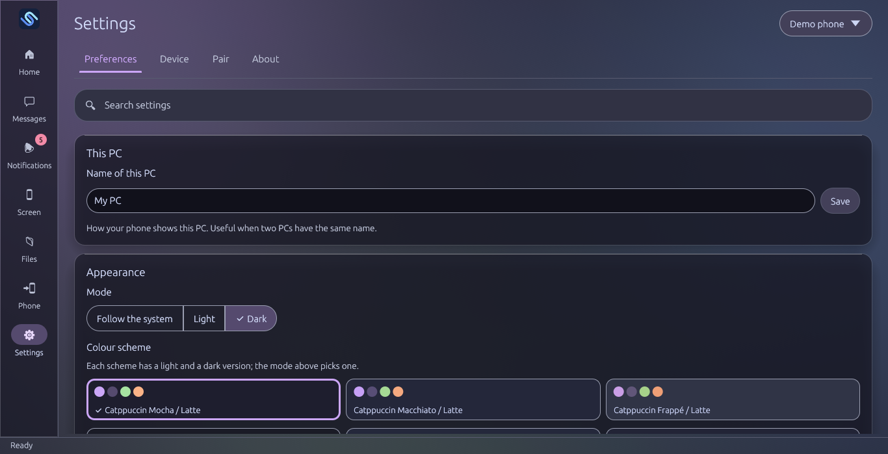

<div align="center">


# Broche

**Your Android phone and your Linux PC, working as one.**
Over your own network or a USB cable, end-to-end encrypted: no accounts, no cloud.

</div>

Broche is an **independent build based on [NectarLink 0.1.4](https://github.com/thtbee/nectarlink)**
(by Bee, [@thtbee_](https://x.com/thtbee_)). It adds a **Linux desktop app** and adapts the
**Android app**. NectarLink only had Windows and Android apps; Broche is Linux and Android only.
**It is not an official NectarLink release** and is not endorsed by its author.

> [!WARNING]
> **Beta.** Broche works day to day, but expect rough edges, and pairing may need to be redone
> between versions until 1.0. Please [report what breaks](https://github.com/RobertCJLA/broche/issues).
>
> NectarLink's [trademark policy](TRADEMARKS.md) does not allow distributing modified versions
> under its name and logo, so this one is called Broche and has its own icon.

<p align="center">
  
  
</p>
<p align="center">
  
  
  
</p>
<p align="center"><sub>Screenshots with a demo phone and made-up content.</sub></p>

## Install

Download the files from the [latest release](https://github.com/RobertCJLA/broche/releases)
and check them against `SHA256SUMS.txt` (`sha256sum -c SHA256SUMS.txt --ignore-missing`).

| | File | How |
|---|---|---|
| **Linux (recommended)** | `Broche-<version>-x86_64.flatpak` | `flatpak install --user Broche-<version>-x86_64.flatpak` (needs the Flathub remote for the Freedesktop runtime) |
| Linux | `Broche-<version>-x86_64.AppImage` | `chmod +x` it and run it |
| Linux | `Broche-<version>-linux-x86_64.tar.gz` | extract it and run `./install.sh` (installs into `~/.local`; glibc 2.35 or later) |
| **Android 8+** | `Broche-<version>-android.apk` | open it on the phone and allow installing from that app |

Then follow [Getting started](#getting-started).

## What Broche adds and changes

Compared with NectarLink 0.1.4. The [CHANGELOG](CHANGELOG.md) has every change in detail.

### Added

- **A Linux desktop app** (`broche`, written with egui), built on the same Rust core as the
  phone. Highlights:
  - A glass look with Catppuccin and Tokyo Night themes, light and dark. Text contrast is checked
    by a test.
  - A tray menu and a welcome that sets everything up on first start.
  - The **island**: a pill at the top of the screen for calls, transfers (with progress) and
    music, which grows when a call rings.
  - The **shelf**: a panel at the screen's edge with the phone's latest photo, screenshot, clip
    and files; drop files on it to send them, or drag received ones out.
  - **Bluetooth calls**: answer and hang up from the PC and talk through its microphone and
    speakers (needs PipeWire's telephony service and the phone paired in the system's Bluetooth
    settings).
  - **Phone apps in windows of their own** (advanced mode on the phone), resizable.
  - A command palette (Ctrl+K), a History page and a connection check that explains why a phone
    doesn't connect.
  - Album art both ways: the phone's music shows its cover on the PC, and the PC sends the cover
    of what it plays (MPRIS) to the phone.
  - The phone's laser pointer drawn on the PC's screen, and your own buttons in the phone's PC
    shortcuts (open an app or a link, run a command).
  - Automatic clipboard. Password managers' copies are skipped.
  - The phone's notifications as desktop notifications too (optional).
  - The phone's screen in a window of its own, with its sound, and a "Show only the phone"
    window mode.
  - Screen reader names and reading order, checked with AT-SPI (Orca).
- **Linux packages**: Flatpak (the main one), AppImage, and a tarball that runs on glibc 2.35
  (Ubuntu 22.04) and later.
- **Spanish** in both apps, and a language picker in the Android app.
- **Permission profiles** (Notifications only, Basic, Multimedia, Full control) when pairing, on both sides, with each
  permission still adjustable.
- **Device names**: rename the PC or the phone; two devices with the same name are numbered.
- **One video quality** shared by both devices, and a Finger / Tilt choice for the laser pointer.
- **Works without Wi-Fi**: Broche starts with no network and connects over USB (with USB
  debugging on, a USB cable also pairs them), and finds the phone again when the network comes
  back.

### Changed

- **Android**:
  - A simpler layout: Home, Activity and Settings. Settings are grouped in categories, with a
    search.
  - Fewer permissions: the PC can no longer turn the phone's Wi-Fi, Bluetooth or hotspot on
    or off, and advanced mode no longer gives Broche permission to read sensitive
    notifications (such as one-time codes) or control calls in progress (mute, speaker,
    hold) by itself: each has its own switch, off by default, in the phone's advanced-mode
    settings.
  - "Deck" is called **PC shortcuts** and "Elevated" is called **Advanced mode**.
  - Webcam at 720p by default.
- **Security**:
  - The PC's device key lives in the desktop keyring. Its files are readable only by you.
  - LocalSend is HTTPS-only, with the certificate checked.
  - Revoking a device ends its session.
  - Dependencies with known advisories were updated.
- **Fixes in the shared core and the video path**:
  - Pausing a transfer that hadn't started yet was lost.
  - The phone's picture froze after turning the phone.
  - "Turn the phone's screen off" works again on Android 16 and later.
  - File descriptors leaked when sending files failed.
- **Everything is renamed to Broche**, including the protocol (`broche/0`). Broche and NectarLink
  can't talk to each other.

### Removed

- The Windows app, its virtual camera and installer, and Windows-only code.
- The auto-updater, the pause for banking apps and the Simplified Chinese translation.
- The phone's brightness control from the PC, the voice recorder and the desk clock.

## What it does

- **Notifications, messages (SMS) and calls** from the phone on the PC, with replies.
  On Linux with PipeWire telephony, pair the phone with the PC in system Bluetooth settings
  to use the PC microphone and speakers for calls. PC audio is enabled when answering from
  Broche; you can turn this off in Settings › Preferences › Bluetooth calls.
- **Clipboard and files** both ways (automatic clipboard optional), with progress in the window
  and the island; browse the phone from the PC, and the PC's `~/Broche` folder from the phone
  (with permission).
- **Photos** from the phone, the phone's **screen and camera** on the PC, the **PC's screen** on
  the phone, remote **mouse and keyboard**, and phone apps in windows of their own.
- **Sound**: the phone as the PC's speaker, the phone's sound on the PC (with its screen, or over
  Bluetooth with one switch on Home, in the tray or with Ctrl+K), PC volume and music (MPRIS)
  from the phone.
- **Find my phone / my PC**, battery, the phone's quick settings, a PC monitor, PC shortcuts, a
  home-screen widget on the phone, and **waking the PC** from the phone (Wake-on-LAN, when the
  PC's BIOS and network card allow it).
- In **English and Spanish**, with Catppuccin and Tokyo Night themes (light and dark).

Video runs at 30 fps by default (60 fps in high quality). Each device's key is stored encrypted:
in the desktop keyring on Linux and in the Android Keystore on the phone. Devices find each other
on the local network or over USB. To connect through encrypted relays, enable
**Connect over mobile data** on Android and use `broche-cli --away` on Linux.
The Linux desktop app does not currently offer relay mode.

## What it doesn't do

- **No virtual webcam.** The phone's camera shows in Broche's window, where you can save a photo
  or scan a document; video-call apps on the PC can't use it as a camera.
- **Copied images go one way.** Text goes both ways; images go from the phone to the PC ("Copy to
  PC", its tile, or the **Copy to PC clipboard** share entry), not from the PC to the phone.
- **Call audio needs Bluetooth.** Over the network, Broche shows calls and answers or hangs them
  up, but Android doesn't let apps carry call audio: pair the phone with the PC by Bluetooth.
- **Some phone features need more access.** Controlling the phone's screen needs Broche's
  accessibility service or advanced mode (Wireless debugging or root). Phone apps in windows and
  copying in the background need advanced mode; call control and sensitive notifications need it
  and their own switch, off by default.
- **It doesn't change your settings for you.** Bluetooth pairing, Wi-Fi and Android permissions are
  yours to set; Broche explains what each one is for.
- **No updater, no account, no cloud.** Install new versions yourself. Relay servers are used only
  with **Connect over mobile data**, and they only pass on encrypted traffic.
- **Linux and Android only.** There is no Windows, macOS or iPhone app.

## Layout

```
apps/linux/       Desktop app `broche` (egui) and its packaging                  (GPL)
apps/android/     Android app (Kotlin, Jetpack Compose)                          (GPL)
apps/cli/         Command-line client `broche-cli`                               (GPL)
crates/           Shared Rust core: protocol, sessions, pairing, FFI, ADB        (MPL-2.0)
scripts/          Packaging, releases, version bumps and the privacy check
docs/             Protocol and technical documentation                           (CC BY 4.0)
```

## Build from source on Linux

The **Flatpak** is the main format: it bundles ffmpeg, GStreamer and the PipeWire tools, so it
works the same on every distribution. An AppImage and a tarball are also available.

```sh
# Flatpak (needs flatpak-builder and the Freedesktop 26.08 runtime, SDK and Rust extension)
flatpak-builder --user --install --force-clean --state-dir=target/flatpak/state \
  target/flatpak/build apps/linux/packaging/flatpak/io.github.robertcjla.Broche.yml

# Tarball / AppImage (needs Rust from rustup and gcc)
cargo build --release -p broche-gui -p broche-cli
APPIMAGE=0 scripts/package-linux.sh          # tar.gz in target/package/
target/package/Broche-*-linux-*/install.sh   # installs into ~/.local
```

Outside the Flatpak it uses, when installed: PipeWire (`pw-play`, `pw-record`, `wpctl`), `ffmpeg`
(the phone's screen and camera) and GStreamer with `openh264enc` and `pipewiresrc` (sharing the
PC's screen); **About** lists what is missing. The window runs through XWayland on Wayland
desktops. Details, including the Flatpak's permissions, in
[apps/linux/README.md](apps/linux/README.md).

## Build the Android app from source

You need JDK 17, the Android SDK (platform 37 and the NDK), Rust's Android targets and
`cargo-ndk`. Details in [apps/android/README.md](apps/android/README.md).

```sh
cd apps/android
./gradlew assembleDebug -Pbroche.abis=arm64-v8a
adb install -r app/build/outputs/apk/debug/app-debug.apk
```

## Getting started

1. Open Broche on the PC: the welcome guides you through language, theme and pairing. Later,
   pair from **Settings › Pair › Show pairing code**.
2. On the phone, open Broche and scan the code. Both need to be on the same network; or connect
   the phone by USB with USB debugging on.
3. Pick a permission profile for the phone; **Settings › Device** on the PC changes it, or each
   permission one by one.
4. For calls through the PC, pair the phone in the system's Bluetooth settings too; the welcome
   and **Settings › Preferences** explain the steps.

More documentation: [technical](docs/technical/README.md), [protocol](docs/protocol/v0.md),
[versioning](docs/VERSIONING.md) and the [CHANGELOG](CHANGELOG.md).

## License and credits

- Apps and client: [GPL-3.0-or-later](LICENSES/GPL-3.0-or-later.txt), with an
  [app store exception](LICENSES/APP-STORE-EXCEPTION.md).
- Core libraries: [MPL-2.0](LICENSES/MPL-2.0.txt).
- Protocol and documentation: [CC BY 4.0](LICENSES/CC-BY-4.0.txt).

Based on NectarLink, © the NectarLink contributors; the original notices are kept. The NectarLink
name and logo are covered by its [trademark policy](TRADEMARKS.md). See [LICENSE](LICENSE).
